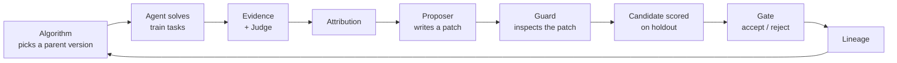

<h1 align="center">OpenRSI</h1>

<p align="center">
  <b>A component-based framework and open protocol for agent recursive self-improvement.</b><br>
  Every stage of the self-improvement loop is a standalone MCP server. Use one piece in your own stack,
  or wire them all together with a single <code>openrsi.yaml</code>.
</p>

<p align="center">
  <a href="https://github.com/TraceLite-AI/openrsi/actions/workflows/ci.yml"></a>
  <a href="LICENSE"></a>
  
  <a href="spec/PROTOCOL.md"></a>
  
</p>

<p align="center">
  <b>English</b> · <a href="README.zh-CN.md">简体中文</a>
</p>

<p align="center">
  <a href="#news">News</a> ·
  <a href="#why-openrsi">Why OpenRSI</a> ·
  <a href="#how-it-works">How It Works</a> ·
  <a href="#quick-start">Quick Start</a> ·
  <a href="#experiments">Experiments</a> ·
  <a href="#integrations">Integrations</a> ·
  <a href="#documentation">Documentation</a>
</p>

---

## News

- **2026-10** · v0.4: six evolution algorithms (GEPA-style Pareto, ShinkaEvolve, AlphaEvolve-style islands, MAP-Elites, archive, greedy), per-task no-regression gating, harness (agent code) and model-weight evolution, and adapters for [verl](https://github.com/volcengine/verl) and [RSIHub](https://github.com/simple-agent-lab/RSIHub).
- **2026-10** · An end-to-end pipeline that evolves a small model's system prompt and weights together ran on a real model (Qwen2.5-0.5B, CPU). GPU-scale results are [pending](#experiments).
- **2026-10** · Component-design tests: every algorithm/gate combination, identical lineage across in-process / stdio / HTTP transports, and a JavaScript component dropped into the Python loop.

## Why OpenRSI

Most self-improvement systems are monolithic: the evaluator, the search algorithm and the thing being improved are tied to one codebase. OpenRSI splits the loop into components with a published protocol, so they can be swapped, reused and audited independently.

- **Components, not a monolith.** 13 component kinds (environment, agent, evidence, judge, attribution, evolvable, memory, skill, proposer, algorithm, gate, guard, lineage). Each one is an MCP server with a fixed set of tools.
- **Evolve anything.** Memory, prompts, executable skills, the agent's own code (harness), model weights, and the judge itself, alone or several at once.
- **Use one piece.** Any MCP client (Claude Code, Cursor, another framework, another language) can call a single component. A gate written in JavaScript from the spec alone passes conformance and runs inside the Python loop.
- **Safe by construction.** The runtime enforces data isolation. A guard inspects every patch before it applies. A gate admits only real holdout gains, optionally with no per-task regressions. Judge changes are validated against human labels.
- **Frontier search.** Pareto frontiers (GEPA), novelty screening and adaptive proposer selection (ShinkaEvolve), island models (AlphaEvolve), MAP-Elites and open-ended archives (Darwin Gödel Machine).
- **Interoperable.** Use the judge as a [verl](https://github.com/volcengine/verl) reward function or a [DSPy](https://github.com/stanfordnlp/dspy) metric, and OpenRSI components as [RSIHub](https://github.com/simple-agent-lab/RSIHub) operators.

## How It Works



A **version** maps each evolvable to one of its snapshots, for example *prompt snapshot + weights checkpoint*. Every patch creates a new snapshot. Rollback is always possible, and rejected candidates stay in the lineage for audit.

The runtime enforces these rules itself rather than trusting components to follow them:

1. The agent never sees `task.reference` (the answer) or the judge's rubric.
2. Only **train** episodes reach attribution and proposers. Holdout and final tasks are used only for scoring.
3. If the environment mislabels a split, the run stops.
4. A patch the guard blocks is never applied; it is recorded as rejected.
5. A judge change is accepted only if agreement with a human-labelled anchor set improves. Agent and judge evolve in alternate generations.

### What can evolve

| Evolvable | Snapshot | Patch | Package |
|---|---|---|---|
| Memory | item set | add / replace / remove items | `openrsi-memory` |
| Prompt | ordered sections | add / replace / remove sections | `openrsi-evolvables` |
| Skills | Python functions, run in a sandboxed subprocess | add / replace / remove code | `openrsi-evolvables` |
| Harness (agent code) | git commit | write / delete / unified diff, within mutable paths | `openrsi-harness` |
| Model weights | checkpoint | one training run (SFT via `train_sft.py` or verl) | `openrsi-verl` |
| Judge rubric | rubric items | add / tighten checks; gated on human-label agreement | `openrsi-judge` |
| Improver strategy (meta) | notes / parameters the proposer reads | replace; gated on downstream gain | `openrsi-evolvables` |
| Curriculum (meta) | tag weights for picking train tasks | replace; gated on downstream gain | `openrsi-evolvables` |

Meta evolvables (`loop.meta_every`) are never shown to the agent and never changed in ordinary generations. In a meta generation the runtime runs one ordinary round under the current and under the candidate meta state with the same budget, and keeps the candidate only if the improvement it produces on holdout is larger; the accepted version carries that improvement with it. Judges and attribution methods are upgraded by the outer loop (`runtime/openrsi_runtime/outer.py`), which can generate and validate candidates on its own but never promotes without a named approver. `runtime/openrsi_runtime/nesting.py` wraps a whole inner run as an agent (`LoopAgent` + `GainJudge`), so an outer loop can evolve the inner loop's algorithm, proposer or attribution; the inner env, judge, gate, guard, lineage and budget stay fixed. Gate, guard, sealed tests, human labels and budgets are never evolved.

### Components

| Kind | Official implementation | Package |
|---|---|---|
| judge, evidence | `EvidenceJudge` (rubric + evidence, optional LLM checks), `EvolvingJudge`; `GainJudge` scores a nested run | `openrsi-judge`, `openrsi-runtime` |
| attribution | `RubricEvidenceAttributor`, `CellContrastAttributor` (blames environment coordinates when a task fails in some cells only); counterfactual reruns in the runtime | `openrsi-attribution` |
| proposer | `LessonProposer`, `ClaudeProposer`, `RubricAuditor`, `CompositeProposer`, `RoutedProposer` (picks a member by where the attribution points), `CurriculumProposer` and `StrategyRewriter` (meta layer), `PromptRewriter`, `DistillProposer` | `openrsi-proposer`, `openrsi-llm`, `openrsi-verl` |
| algorithm | 6 algorithms, see below | `openrsi-algorithm` |
| gate | `HoldoutGate` (gain, significance, paired per-task significance, anchor, cost, per-task and per-cell no-regression) | `openrsi-gate` |
| guard | `PolicyGuard` (dangerous code, secrets, protected items and paths, eval tampering) | `openrsi-guard` |
| lineage | `LineageStore` (JSONL, resumable) | `openrsi-lineage` |
| agent | `ChatAgent` (any OpenAI-compatible endpoint, restarts vLLM when weights change), `HarnessAgent`, `LoopAgent` (a whole inner run) | `openrsi-llm`, `openrsi-harness`, `openrsi-runtime` |
| evolvable, memory, skill | see the table above | |
| env | user-provided; examples include GSM8K | |

### Evolution algorithms

| `--kind` | Inspired by | Parent selection |
|---|---|---|
| `greedy` | hill climbing | always the best version |
| `archive` | Darwin Gödel Machine | every accepted version, weighted by score and child count |
| `pareto` | GEPA, Meta-Harness | per-task frontier: any version that is best on some task stays; dominated ones are pruned |
| `shinka` | ShinkaEvolve | sigmoid score weighting, novelty screening before evaluation (`rsi_algorithm_screen`), UCB over proposers |
| `islands` | AlphaEvolve, FunSearch | independent islands with periodic migration of the best version |
| `map-elites` | MAP-Elites | one elite per behaviour cell; cells sampled uniformly |

## Quick Start

Requires Python 3.10+.

```bash
git clone https://github.com/TraceLite-AI/openrsi && cd openrsi
pip install -e sdk/python -e runtime -e components/judge -e components/memory -e components/attribution \
            -e components/proposer -e components/algorithm -e components/gate -e components/lineage \
            -e components/evolvables -e components/guard -e components/harness -e components/llm -e adapters/verl

cd examples/secret_ops
openrsi run      # runs until done; rerunning resumes from the lineage
openrsi log      # show the lineage
```

Each of 8 symbols hides an unknown binary operation. The agent looks up rules in memory, and the proposer induces rules from failed train tasks. No model or API key is needed. Output:

```
 gen  parent                train    base    cand  result
  · root snap_root: holdout=0.000
   1  snap_root             0.111   0.000   0.375  accepted snap_7f0d3e1244746973
   2  snap_7f0d3e124474697  0.667   0.375   0.500  accepted snap_7df638e7d96838e1
  ...
   8  snap_f474c409fda4e93  0.778   0.875   1.000  accepted snap_0145c98ef4d8eda8
```

### Evolve a small model's prompt and weights

```bash
cd examples/small_model
python make_toy_data.py toy_data && openrsi run openrsi.mock.yaml   # mock model, seconds, no GPU
openrsi run openrsi.cpu.yaml                                         # Qwen2.5-0.5B on CPU via transformers, ~1 h
openrsi run openrsi.yaml                                             # Qwen2.5-0.5B on one GPU via vLLM
```

Each generation, ShinkaEvolve's UCB picks one of two proposers: rewrite the system prompt from failed train tasks, or fine-tune on trajectories the judge passed (rejection-sampling self-distillation). When the weights change, `ChatAgent` restarts the inference server on the new checkpoint. See [examples/small_model](examples/small_model/README.md).

### More examples

| Example | Shows |
|---|---|
| [`secret_ops`](examples/secret_ops) | the full loop with memory; one component runs as a separate MCP process |
| [`skill_ops`](examples/skill_ops) | evolving executable skills; the guard blocks a patch that imports `os` |
| [`judge_coevolution`](examples/judge_coevolution) | a judge that misses test tampering is fixed, gated on human labels, then the agent stops cheating |
| [`harness_ops`](examples/harness_ops) | evolving the agent's own code in a git repo; an edit to `eval/` is blocked |
| [`small_model`](examples/small_model) | real LLM; system prompt and weights evolve together |
| [`judge_standalone.py`](examples/judge_standalone.py) | using the judge alone, in-process and over MCP |

## Use a Single Component

In Python:

```python
from openrsi_judge import EvidenceJudge

judge = EvidenceJudge({"items": [{"id": "tests_pass", "check": "tests_pass", "required": True},
                                 {"id": "no_test_edits", "check": "no_protected_edits", "required": True}]},
                      protect=["tests/**"])
verdict = judge.evaluate(task, trajectory, judge.collect(task, trajectory))
```

As an MCP server for any client:

```bash
openrsi-judge --rubric rubric.yaml --protect 'tests/**'
openrsi-serve openrsi_gate:HoldoutGate --with '{"min_gain": 0.01}'                       # any component class
openrsi-serve my_pkg:MyJudge --transport streamable-http --port 8765
```

Write your own component by subclassing an SDK base class, then run the conformance suite:

```python
from openrsi import Gate, GateDecision, serve

class MyGate(Gate):
    name, version = "me/my-gate", "0.1.0"
    def check(self, request):
        ok = request.candidate["holdout"] > request.baseline["holdout"]
        return GateDecision(candidate_id=request.candidate_id, accepted=ok)

serve(MyGate())
```

```bash
openrsi-conformance -- python my_gate.py
```

Other languages need no SDK: implement the tools in [`spec/tools.json`](spec/tools.json). [`tests/xlang/gate.mjs`](tests/xlang/gate.mjs) is a gate written in JavaScript from the spec alone.

Any slot in `openrsi.yaml` can be in-process (`python:`), a subprocess (`command:`), or remote (`url:`):

```yaml
protocol: openrsi/0.4
components:
  env:       {python: "my_components:MyEnv"}
  judge:     {python: "openrsi_judge:EvidenceJudge", with: {rubric: rubric.yaml}}
  evidence:  {same_as: judge}
  memory:    {command: [openrsi-memory, --path, .openrsi/memory]}
  algorithm: {python: "openrsi_algorithm:ShinkaAlgorithm", with: {proposers: [prompt, weights]}}
  gate:      {python: "openrsi_gate:HoldoutGate", with: {max_task_regressions: 0}}
  lineage:   {url: "https://lineage.internal/mcp"}
evolvables:
  prompt:    {python: "openrsi_evolvables:PromptEvolvable"}
```

Environment cells (draft for 0.5, opt-in): an env that implements `rsi_env_cells` declares cells (environment coordinates plus pinned versions; see [the draft](spec/drafts/environment-cells.md)). Add a `cells:` section to run each task once per cell. The runtime keys per-task scores as `<task_id>@<cell_id>`, stops if a cell's fingerprint changes or a task's `env_ref` is wrong, and records the cells in the lineage. Without `cells:` a run behaves exactly as in 0.4. Each episode also gets an `env_cell` evidence record (cell, coordinates, fingerprint) written by the runtime, which `CellContrastAttributor` uses to compare the same task across cells. The runtime checks declarations only; it does not make the agent actually run in that environment. For that, add `cells.binding` (strict mode): before every task the runtime prepares the cell, runs pre-registered probes in a subprocess and compares them with the declared coordinates, and the agent must report the plan it used (`HarnessAgent` does). With `records: {path}` the raw tasks, trajectories, evidence and receipts are stored content-addressed and append-only, verdicts and attributions as derived records, and resuming with a different run manifest is refused. `runtime/openrsi_runtime/outer.py` upgrades a judge or an attribution method only after a frozen validation plan passes on independent labels and someone approves; off by default.

```yaml
cells:
  train:   [linux-utf8]
  holdout: [linux-utf8, linux-cp1252]
```

## Integrations

| Framework | What OpenRSI provides | Tested against the real framework |
|---|---|---|
| Any MCP client | every component | yes (Python and JavaScript clients) |
| [verl](https://github.com/volcengine/verl) | judge as `compute_score` reward; RL/SFT data export that refuses non-train data; model weights as an evolvable | not yet ([field tests](field_tests/README.md) ready) |
| [RSIHub](https://github.com/simple-agent-lab/RSIHub) | guard `validate`, no-regression `gate`, Shinka `select` operators; archive import | not yet ([field tests](field_tests/README.md), [parity benchmark](benchmarks/rsihub_parity/README.md) ready) |
| [DSPy](https://github.com/stanfordnlp/dspy) | judge as a metric, including GEPA feedback | with stubs only |
| [LangGraph](https://github.com/langchain-ai/langgraph) | state to trajectory conversion | with stubs only |
| vLLM / any OpenAI-compatible API | `ChatAgent` and `PromptRewriter` | transformers server on CPU; vLLM pending |

## Experiments

Results marked *pending* need GPUs or paid APIs. The scripts are in the repository, and the tables will be filled in once the runs complete.

### 1. Small model: system prompt + weights on GSM8K

[`examples/small_model/openrsi.yaml`](examples/small_model/openrsi.yaml), Qwen2.5-0.5B-Instruct, 64 train tasks per generation, 200 holdout tasks, 8 generations.

<!-- RESULTS:small-model-gpu -->
| Setting | Root holdout | Best holdout | Accepted (prompt / weights) | Final split | Wall-clock |
|---|---|---|---|---|---|
| prompt + weights (vLLM, 1 GPU) | *pending* | *pending* | *pending* | *pending* | *pending* |
| prompt only | *pending* | *pending* | *pending* | *pending* | *pending* |
| weights only | *pending* | *pending* | *pending* | *pending* | *pending* |

A small run on CPU (12 train / 15 holdout tasks, 3 generations) completed end to end. Root holdout 0.20. The SFT candidate (4 examples) scored 0.13 and was rejected by the gate. The run surfaced four issues that the mock pipeline could not, all fixed; see [examples/small_model](examples/small_model/README.md#在-cpu-上实际跑过的结果).

### 2. RSIHub parity: Terminal-Bench 2 × MiniSWE × Hyperagents

[`benchmarks/rsihub_parity`](benchmarks/rsihub_parity/README.md) runs RSIHub's own evaluator twice. The two arms differ only in the validate and gate operators. 89 tasks, split 50 / 19 / 20, GPT-5.4.

<!-- RESULTS:rsihub-parity -->
| Arm | Train (seed → best) | Full benchmark (seed → best) | Accepted / generations | Blocked by guard | Cost |
|---|---|---|---|---|---|
| RSIHub published | 58.0% → 68.0% | 56.2% → 69.7% | — | — | — |
| baseline (our run) | *pending* | *pending* | *pending* | *pending* | *pending* |
| + OpenRSI guard and no-regression gate | *pending* | *pending* | *pending* | *pending* | *pending* |

### 3. verl

[`field_tests/verl`](field_tests/README.md).

<!-- RESULTS:verl -->
| Test | Result |
|---|---|
| V1: OpenRSI reward vs verl's built-in GSM8K reward, per-sample agreement | *pending* |
| V3: GRPO, Qwen2.5-0.5B, validation score before → after, OpenRSI reward vs built-in | *pending* |
| V4: two chained SFT runs through `WeightsEvolvable`, then rollback | *pending* |

### 4. Native loop A/B/C (synthetic smoke, not a benchmark)

[`benchmarks/native_loop`](benchmarks/native_loop/README.md): A = no improvement, B = equal search budget but every generation starts from the root, C = equal budget and improvements are inherited. Budget 400 agent calls per arm; sealed test of 40 tasks run once per arm after the final version is locked.

<!-- RESULTS:native-loop -->
| Arm | Sealed pass rate (seed 0 / 1 / 2) |
|---|---|
| A: frozen | 0.000 / 0.125 / 0.125 |
| B: independent from root | 0.375 / 0.500 / 0.500 |
| C: inherits improvements | 1.000 / 1.000 / 1.000 |

This is the `secret_ops` toy task: it shows the machinery works, not how well a real agent improves.

### 5. Cost of the component split (measured)

[`benchmarks/composition/overhead.py`](benchmarks/composition/overhead.py), Python 3.13, 4-core CPU:

| Transport | Gate check | Judge one task (evidence + verdict) |
|---|---|---|
| in-process | 0.003 ms | 0.025 ms |
| subprocess (stdio) | 2.4 ms | 5.4 ms |
| streamable HTTP | 3.4 ms | 7.0 ms |

A full `secret_ops` run (8 generations) takes 0.07 s in-process and 14 s with every component in its own process. Real agents spend seconds to minutes per task, so the overhead is negligible. Components called on every agent step should stay in-process.

## Project Status

OpenRSI is alpha software (protocol `openrsi/0.4`). Protocol versions so far have only added fields and tools, so components built for an older version still work.

- **Tested in CI:** 284 tests on Python 3.10–3.13: protocol conformance, data isolation, every algorithm/gate combination, transport equivalence, cross-language components, crash and resume, and five end-to-end examples.
- **Run on a real model:** the small-model pipeline on CPU.
- **Not yet run for real:** GPU-scale small-model runs, verl training, RSIHub recipes. See [Experiments](#experiments).

## Roadmap

- [ ] Fill in the experiment tables above
- [ ] Reinforcement learning (GRPO via verl) as a weights patch inside the loop, not only SFT
- [ ] Run OpenRSI's own runtime on Terminal-Bench 2 and τ³-bench via Harbor, with the same splits as RSIHub
- [ ] TypeScript SDK
- [ ] Adapters for OpenEvolve, Letta, OpenAI Agents SDK
- [ ] English translation of the protocol specification

## Documentation

The protocol specification and in-repo guides are currently written in Chinese. English translations are planned.

| Document | Content |
|---|---|
| [spec/PROTOCOL.md](spec/PROTOCOL.md) | the protocol: component kinds, tools, data isolation, versioning |
| [spec/tools.json](spec/tools.json), [spec/schemas/](spec/schemas) | machine-readable tool and data schemas |
| [examples/small_model/README.md](examples/small_model/README.md) | the small-model pipeline |
| [field_tests/README.md](field_tests/README.md) | tests to run against real verl and RSIHub |
| [benchmarks/rsihub_parity/README.md](benchmarks/rsihub_parity/README.md) | the RSIHub parity experiment |
| [benchmarks/native_loop/README.md](benchmarks/native_loop/README.md) | the native A/B/C experiment |
| [REVIEW.md](REVIEW.md) | the review checklist and per-version baselines |

## Repository Layout

```
spec/               protocol, JSON Schemas and tool definitions (generated)
sdk/python/         openrsi-sdk: data types, component base classes, MCP server/client, conformance suite, openrsi-serve
runtime/            openrsi-runtime: wires components from openrsi.yaml, runs and resumes the loop
components/         official components: judge, memory, evolvables, harness, llm, attribution,
                    proposer, algorithm, gate, guard, lineage
adapters/           verl, RSIHub, DSPy, LangGraph
examples/           runnable examples
benchmarks/         RSIHub parity, native A/B/C, composition overhead
field_tests/        tests to run on real frameworks and hardware
tests/              unit and integration tests, including tests/xlang (JavaScript)
```

## Contributing

```bash
pip install -e sdk/python -e runtime -e components/* -e adapters/* pytest ruff
npm ci --prefix tests/xlang          # optional, for the cross-language tests
pytest
ruff check .
python -m openrsi.export_spec spec   # after changing sdk/python/openrsi/types.py or protocol.py
```

New or changed components need an updated `rsi-component.yaml` manifest. Reviews start from the three questions in [REVIEW.md](REVIEW.md).

## Citation

```bibtex
@software{openrsi2026,
  title  = {OpenRSI: A Component-Based Framework and Open Protocol for Agent Recursive Self-Improvement},
  author = {{OpenRSI contributors}},
  year   = {2026},
  url    = {https://github.com/TraceLite-AI/openrsi}
}
```

## Acknowledgements

OpenRSI builds on the [Model Context Protocol](https://modelcontextprotocol.io) and draws on ideas from GEPA, ShinkaEvolve, AlphaEvolve, Darwin Gödel Machine, MAP-Elites, Self-Harness and AHE. It integrates with verl, RSIHub, DSPy and LangGraph.

## License

[Apache License 2.0](LICENSE)
