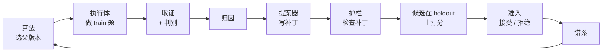

<h1 align="center">OpenRSI</h1>

<p align="center">
  <b>组件式的 agent 递归自我改进（RSI）框架与开放协议。</b><br>
  自我改进循环的每个环节都是一个独立的 MCP server：可以只拿其中一个接进你自己的系统，
  也可以用一份 <code>openrsi.yaml</code> 把它们接成完整的循环。
</p>

<p align="center">
  <a href="https://github.com/zsicheng0214/openrsi/actions/workflows/ci.yml"></a>
  <a href="LICENSE"></a>
  
  <a href="spec/PROTOCOL.md"></a>
  
</p>

<p align="center">
  <a href="README.md">English</a> · <b>简体中文</b>
</p>

<p align="center">
  <a href="#新闻">新闻</a> ·
  <a href="#为什么是-openrsi">为什么是 OpenRSI</a> ·
  <a href="#工作原理">工作原理</a> ·
  <a href="#快速开始">快速开始</a> ·
  <a href="#实验">实验</a> ·
  <a href="#框架集成">框架集成</a> ·
  <a href="#文档">文档</a>
</p>

---

## 新闻

- **2026-10** · v0.4：6 种进化算法（GEPA 式 Pareto、ShinkaEvolve、AlphaEvolve 式岛屿、MAP-Elites、档案、贪心）、逐题不回退准入、harness（agent 代码）和模型权重进化，以及 [verl](https://github.com/volcengine/verl)、[RSIHub](https://github.com/simple-agent-lab/RSIHub) 适配器。
- **2026-10** · 小模型同时进化系统提示和权重的全流程，在真实模型上跑通（Qwen2.5-0.5B，CPU）。GPU 规模的结果[待补](#实验)。
- **2026-10** · 组件化设计的测试：所有算法 × 准入组合；进程内、stdio、HTTP 三种传输方式得到的谱系完全一致；JavaScript 写的组件能直接接进 Python 循环。

## 为什么是 OpenRSI

大多数自我改进系统是一体的：评估器、搜索算法和被改进的对象绑在同一套代码里。OpenRSI 把循环拆成组件，用公开的协议连接，每个组件都能单独替换、复用和审计。

- **组件化，而不是一整块。** 协议定义 13 类组件：环境、执行体、取证、判别、归因、可进化体、memory、skill、提案、算法、准入、护栏、谱系。每个组件都是一个 MCP server，暴露固定的一组工具。
- **什么都能进化。** memory、prompt、可执行的 skill、agent 自己的代码（harness）、模型权重，以及判别器本身。可以单独进化一个，也可以同时进化多个。
- **只用其中一个也行。** 任何 MCP 客户端（Claude Code、Cursor、其他框架、其他语言）都能调用单个组件。只照着协议用 JavaScript 写的准入组件，能通过一致性测试，也能直接跑在 Python 的循环里。
- **安全靠机制保证。** 运行时强制数据隔离；每个补丁生效前都经过护栏检查；准入只接受在 holdout 上真正变好的候选，可以要求逐题不回退；判别器的修改要用人工标注集验证。
- **前沿的搜索算法。** Pareto 前沿（GEPA）、新颖度筛查和自适应选提案器（ShinkaEvolve）、岛屿模型（AlphaEvolve）、MAP-Elites 和开放式档案（Darwin Gödel Machine）。
- **能和现有框架互通。** 判别器可以当 [verl](https://github.com/volcengine/verl) 的奖励函数、[DSPy](https://github.com/stanfordnlp/dspy) 的 metric；组件可以当 [RSIHub](https://github.com/simple-agent-lab/RSIHub) 的算子。

## 工作原理



一个**版本**由每个可进化体各取一个快照组成，比如"系统提示快照 + 权重 checkpoint"。每个补丁生成新快照，随时可以回滚；被拒绝的候选也留在谱系里，供审计。

下面几条规则由运行时强制执行，不依赖组件自觉：

1. 执行体看不到 `task.reference`（标准答案），也看不到判别器的 rubric。
2. 只有 **train** 的结果会进入归因和提案；holdout 和 final 只用来打分。
3. 环境把题目划分标错，运行立即停止。
4. 被护栏拦下的补丁不会生效，以拒绝状态写进谱系。
5. 判别器的修改只有在与人工标注集（anchor）的一致率提升时才被接受；执行体和判别器轮流进化。

### 可以进化什么

| 可进化体 | 快照 | 补丁 | 包 |
|---|---|---|---|
| memory | 条目集合 | 增、改、删条目 | `openrsi-memory` |
| prompt | 有序段落 | 增、改、删段落 | `openrsi-evolvables` |
| skill | Python 函数，在受限子进程里执行 | 增、改、删代码 | `openrsi-evolvables` |
| harness（agent 代码） | git 提交 | 写入、删除文件或统一 diff，限定在可改范围内 | `openrsi-harness` |
| 模型权重 | checkpoint | 一次训练（`train_sft.py` 或 verl 做 SFT） | `openrsi-verl` |
| 判别器 rubric | rubric 条目 | 增加或收紧检查项，按人工标注一致率准入 | `openrsi-judge` |

### 组件

| 类型 | 官方实现 | 包 |
|---|---|---|
| 判别、取证 | `EvidenceJudge`（rubric + 证据，可选 LLM 检查项）、`EvolvingJudge` | `openrsi-judge` |
| 归因 | `RubricEvidenceAttributor`；运行时支持反事实重跑 | `openrsi-attribution` |
| 提案 | `LessonProposer`、`ClaudeProposer`、`RubricAuditor`、`CompositeProposer`、`PromptRewriter`、`DistillProposer` | `openrsi-proposer`、`openrsi-llm`、`openrsi-verl` |
| 算法 | 6 种，见下表 | `openrsi-algorithm` |
| 准入 | `HoldoutGate`（提升幅度、显著性、anchor、成本、逐题不回退） | `openrsi-gate` |
| 护栏 | `PolicyGuard`（危险代码、密钥、受保护条目和路径、篡改评估） | `openrsi-guard` |
| 谱系 | `LineageStore`（JSONL，可续跑） | `openrsi-lineage` |
| 执行体 | `ChatAgent`（任何 OpenAI 兼容接口，换权重时重启 vLLM）、`HarnessAgent` | `openrsi-llm`、`openrsi-harness` |
| 可进化体、memory、skill | 见上表 | |
| 环境 | 由用户提供；示例里有 GSM8K | |

### 进化算法

| `--kind` | 来源 | 父代选择 |
|---|---|---|
| `greedy` | 爬山 | 总从最好的版本出发 |
| `archive` | Darwin Gödel Machine | 所有被接受的版本，按分数和子代数加权 |
| `pareto` | GEPA、Meta-Harness | 按题前沿：在任何一道题上最好的版本都保留，被支配的去掉 |
| `shinka` | ShinkaEvolve | sigmoid 分数加权、评估前的新颖度筛查（`rsi_algorithm_screen`）、UCB 选提案器 |
| `islands` | AlphaEvolve、FunSearch | 多个岛独立进化，定期把最好的版本迁移到下一个岛 |
| `map-elites` | MAP-Elites | 按行为特征分格，每格留一个最好的，各格机会均等 |

## 快速开始

需要 Python 3.10+。

```bash
git clone https://github.com/zsicheng0214/openrsi && cd openrsi
pip install -e sdk/python -e runtime -e components/judge -e components/memory -e components/attribution \
            -e components/proposer -e components/algorithm -e components/gate -e components/lineage \
            -e components/evolvables -e components/guard -e components/harness -e components/llm -e adapters/verl

cd examples/secret_ops
openrsi run      # 跑到停为止；中断后再运行会从谱系接着跑
openrsi log      # 查看谱系
```

8 个符号，每个背后是一个未知的二元运算。执行体从 memory 里找规则，提案器从答错的 train 题里归纳规则。不需要模型，也不需要 API key。输出：

```
 gen  parent                train    base    cand  result
  · root snap_root: holdout=0.000
   1  snap_root             0.111   0.000   0.375  接受 snap_7f0d3e1244746973
   2  snap_7f0d3e124474697  0.667   0.375   0.500  接受 snap_7df638e7d96838e1
  ...
   8  snap_f474c409fda4e93  0.778   0.875   1.000  接受 snap_0145c98ef4d8eda8
```

### 同时进化小模型的系统提示和权重

```bash
cd examples/small_model
python make_toy_data.py toy_data && openrsi run openrsi.mock.yaml   # 假模型，几秒，不需要 GPU
openrsi run openrsi.cpu.yaml                                         # Qwen2.5-0.5B，CPU 上用 transformers，约 1 小时
openrsi run openrsi.yaml                                             # Qwen2.5-0.5B，1 张 GPU 上用 vLLM
```

每一代由 ShinkaEvolve 的 UCB 在两个提案器里选一个：根据答错的 train 题改写系统提示；或者用判别器判为通过的轨迹做 SFT（拒绝采样式自我蒸馏）。权重变了，`ChatAgent` 会用新 checkpoint 重启推理服务。详见 [examples/small_model](examples/small_model/README.md)。

### 更多示例

| 示例 | 演示什么 |
|---|---|
| [`secret_ops`](examples/secret_ops) | 带 memory 的完整循环；其中一个组件作为独立的 MCP 进程运行 |
| [`skill_ops`](examples/skill_ops) | 进化可执行的 skill；护栏拦下一个 `import os` 的补丁 |
| [`judge_coevolution`](examples/judge_coevolution) | 漏判改测试的判别器被修好（按人工标注准入），随后执行体不再作弊 |
| [`harness_ops`](examples/harness_ops) | 在 git 仓库里进化 agent 自己的代码；改 `eval/` 的补丁被拦下 |
| [`small_model`](examples/small_model) | 真实 LLM，系统提示和权重一起进化 |
| [`judge_standalone.py`](examples/judge_standalone.py) | 单独使用判别器，进程内和走 MCP 两种方式 |

## 只用其中一个组件

在 Python 里：

```python
from openrsi_judge import EvidenceJudge

judge = EvidenceJudge({"items": [{"id": "tests_pass", "check": "tests_pass", "required": True},
                                 {"id": "no_test_edits", "check": "no_protected_edits", "required": True}]},
                      protect=["tests/**"])
verdict = judge.evaluate(task, trajectory, judge.collect(task, trajectory))
```

作为 MCP server 给任何客户端用：

```bash
openrsi-judge --rubric rubric.yaml --protect 'tests/**'
openrsi-serve openrsi_gate:HoldoutGate --with '{"min_gain": 0.01}'                       # 任意组件类
openrsi-serve my_pkg:MyJudge --transport streamable-http --port 8765
```

写自己的组件：继承 SDK 的基类，然后跑一致性测试：

```python
from openrsi import Gate, GateDecision, serve

class MyGate(Gate):
    name, version = "me/my-gate", "0.1.0"
    def check(self, request):
        ok = request.candidate["holdout"] > request.baseline["holdout"]
        return GateDecision(candidate_id=request.candidate_id, accepted=ok)

serve(MyGate())
```

```bash
openrsi-conformance -- python my_gate.py
```

其他语言不需要 SDK，实现 [`spec/tools.json`](spec/tools.json) 里的工具就行。[`tests/xlang/gate.mjs`](tests/xlang/gate.mjs) 是只照着协议用 JavaScript 写的准入组件。

`openrsi.yaml` 里每个位置都可以是进程内（`python:`）、子进程（`command:`）或远程（`url:`）：

```yaml
protocol: openrsi/0.4
components:
  env:       {python: "my_components:MyEnv"}
  judge:     {python: "openrsi_judge:EvidenceJudge", with: {rubric: rubric.yaml}}
  evidence:  {same_as: judge}
  memory:    {command: [openrsi-memory, --path, .openrsi/memory]}
  algorithm: {python: "openrsi_algorithm:ShinkaAlgorithm", with: {proposers: [prompt, weights]}}
  gate:      {python: "openrsi_gate:HoldoutGate", with: {max_task_regressions: 0}}
  lineage:   {url: "https://lineage.internal/mcp"}
evolvables:
  prompt:    {python: "openrsi_evolvables:PromptEvolvable"}
```

## 框架集成

| 框架 | OpenRSI 提供什么 | 是否用真实框架测过 |
|---|---|---|
| 任何 MCP 客户端 | 所有组件 | 是（Python 和 JavaScript 客户端） |
| [verl](https://github.com/volcengine/verl) | 判别器当 `compute_score` 奖励；导出 RL / SFT 数据，拒绝非 train 数据；模型权重作为可进化体 | 还没有（[现场测试](field_tests/README.md)已备好） |
| [RSIHub](https://github.com/simple-agent-lab/RSIHub) | 护栏 `validate`、不回退 `gate`、Shinka `select` 三个算子；导入归档 | 还没有（[现场测试](field_tests/README.md)和[对照实验](benchmarks/rsihub_parity/README.md)已备好） |
| [DSPy](https://github.com/stanfordnlp/dspy) | 判别器当 metric，含 GEPA 反馈 | 只用替身测过 |
| [LangGraph](https://github.com/langchain-ai/langgraph) | 状态转成轨迹 | 只用替身测过 |
| vLLM 及任何 OpenAI 兼容接口 | `ChatAgent`、`PromptRewriter` | CPU 上的 transformers 服务测过；vLLM 待测 |

## 实验

标着"待补"的需要 GPU 或付费 API。脚本都在仓库里，跑完后补进下面的表。

### 1. 小模型：在 GSM8K 上同时进化系统提示和权重

[`examples/small_model/openrsi.yaml`](examples/small_model/openrsi.yaml)：Qwen2.5-0.5B-Instruct，每代 64 道 train、200 道 holdout，8 代。

<!-- RESULTS:small-model-gpu -->
| 设置 | 起点 holdout | 最佳 holdout | 接受数（prompt / 权重） | final 集 | 耗时 |
|---|---|---|---|---|---|
| prompt + 权重（vLLM，1 张 GPU） | 待补 | 待补 | 待补 | 待补 | 待补 |
| 只进化 prompt | 待补 | 待补 | 待补 | 待补 | 待补 |
| 只进化权重 | 待补 | 待补 | 待补 | 待补 | 待补 |

CPU 上的小规模运行（12 道 train、15 道 holdout、3 代）已经跑完：起点 holdout 0.20；用 4 条样本做 SFT 的候选得 0.13，被准入拒绝。这次运行发现了 4 个假模型测不出的问题，都已修复，见 [examples/small_model](examples/small_model/README.md#在-cpu-上实际跑过的结果)。

### 2. 和 RSIHub 对齐：Terminal-Bench 2 × MiniSWE × Hyperagents

[`benchmarks/rsihub_parity`](benchmarks/rsihub_parity/README.md) 用 RSIHub 自己的评测器跑两组，只差 validate 和 gate 两个算子。89 题，按 50 / 19 / 20 划分，GPT-5.4。

<!-- RESULTS:rsihub-parity -->
| 组 | 训练分（seed → best） | 全量分（seed → best） | 接受 / 代数 | 护栏拦下 | 花费 |
|---|---|---|---|---|---|
| RSIHub 公布 | 58.0% → 68.0% | 56.2% → 69.7% | — | — | — |
| baseline（我们跑） | 待补 | 待补 | 待补 | 待补 | 待补 |
| + OpenRSI 护栏和不回退准入 | 待补 | 待补 | 待补 | 待补 | 待补 |

### 3. verl

[`field_tests/verl`](field_tests/README.md)。

<!-- RESULTS:verl -->
| 测试 | 结果 |
|---|---|
| V1：OpenRSI 奖励和 verl 自带 GSM8K 奖励逐条对比的一致率 | 待补 |
| V3：GRPO，Qwen2.5-0.5B，验证分训练前 → 训练后，OpenRSI 奖励对比自带奖励 | 待补 |
| V4：通过 `WeightsEvolvable` 连续两次 SFT，再回滚 | 待补 |

### 4. 组件化的开销（已测）

[`benchmarks/composition/overhead.py`](benchmarks/composition/overhead.py)，Python 3.13，4 核 CPU：

| 传输方式 | 准入一次 | 判别一道题（取证 + 判决） |
|---|---|---|
| 进程内 | 0.003 ms | 0.025 ms |
| 子进程（stdio） | 2.4 ms | 5.4 ms |
| streamable HTTP | 3.4 ms | 7.0 ms |

`secret_ops` 跑完 8 代：全部进程内 0.07 秒，每个组件单独一个进程 14 秒。真实 agent 每道题要几秒到几分钟，这点开销可以忽略；每一步都要调用的组件应当放在进程内。

## 项目状态

OpenRSI 处于 alpha 阶段（协议 `openrsi/0.4`）。到目前为止，协议的每个版本都只增加字段和工具，旧版本的组件不用改就能用。

- **CI 覆盖：** 166 个测试，Python 3.10～3.13。包括协议一致性、数据隔离、所有算法 × 准入组合、传输方式等价、跨语言组件、崩溃与续跑，以及 5 个端到端示例。
- **在真实模型上跑过：** 小模型全流程（CPU）。
- **还没真实跑过：** GPU 规模的小模型实验、verl 训练、RSIHub 配方。见[实验](#实验)。

## 路线图

- [ ] 补齐上面的实验表
- [ ] 把强化学习（通过 verl 做 GRPO）作为循环里的一种权重补丁，不只是 SFT
- [ ] 用 OpenRSI 自己的运行时，通过 Harbor 跑 Terminal-Bench 2 和 τ³-bench，划分和 RSIHub 一致
- [ ] TypeScript SDK
- [ ] OpenEvolve、Letta、OpenAI Agents SDK 适配器
- [ ] 协议规范的英文版

## 文档

| 文档 | 内容 |
|---|---|
| [spec/PROTOCOL.md](spec/PROTOCOL.md) | 协议：组件类型、工具、数据隔离、版本规则 |
| [spec/tools.json](spec/tools.json)、[spec/schemas/](spec/schemas) | 机器可读的工具定义和数据格式 |
| [examples/small_model/README.md](examples/small_model/README.md) | 小模型全流程 |
| [field_tests/README.md](field_tests/README.md) | 在真实 verl、RSIHub 上跑的测试 |
| [benchmarks/rsihub_parity/README.md](benchmarks/rsihub_parity/README.md) | 和 RSIHub 拉齐的对照实验 |
| [REVIEW.md](REVIEW.md) | 审查清单和各版本基线 |

## 目录结构

```
spec/               协议、JSON Schema 和工具定义（自动生成）
sdk/python/         openrsi-sdk：数据格式、组件基类、MCP 服务端和客户端、一致性测试、openrsi-serve
runtime/            openrsi-runtime：按 openrsi.yaml 接通组件，运行和续跑循环
components/         官方组件：judge、memory、evolvables、harness、llm、attribution、
                    proposer、algorithm、gate、guard、lineage
adapters/           verl、RSIHub、DSPy、LangGraph
examples/           能直接跑的示例
benchmarks/         RSIHub 对照实验、组件化开销
field_tests/        要在真实框架和硬件上跑的测试
tests/              单元测试和集成测试，含 tests/xlang（JavaScript）
```

## 参与开发

```bash
pip install -e sdk/python -e runtime -e components/* -e adapters/* pytest ruff
npm ci --prefix tests/xlang          # 可选，跨语言测试需要
pytest
ruff check .
python -m openrsi.export_spec spec   # 改了 sdk/python/openrsi/types.py 或 protocol.py 之后
```

新增或修改组件时，同步更新它的 `rsi-component.yaml`。审查从 [REVIEW.md](REVIEW.md) 里的三个问题出发。

## 引用

```bibtex
@software{openrsi2026,
  title  = {OpenRSI: A Component-Based Framework and Open Protocol for Agent Recursive Self-Improvement},
  author = {{OpenRSI contributors}},
  year   = {2026},
  url    = {https://github.com/zsicheng0214/openrsi}
}
```

## 致谢

OpenRSI 基于 [Model Context Protocol](https://modelcontextprotocol.io)，借鉴了 GEPA、ShinkaEvolve、AlphaEvolve、Darwin Gödel Machine、MAP-Elites、Self-Harness 和 AHE 的思路，并与 verl、RSIHub、DSPy、LangGraph 集成。

## 许可证

[Apache License 2.0](LICENSE)
